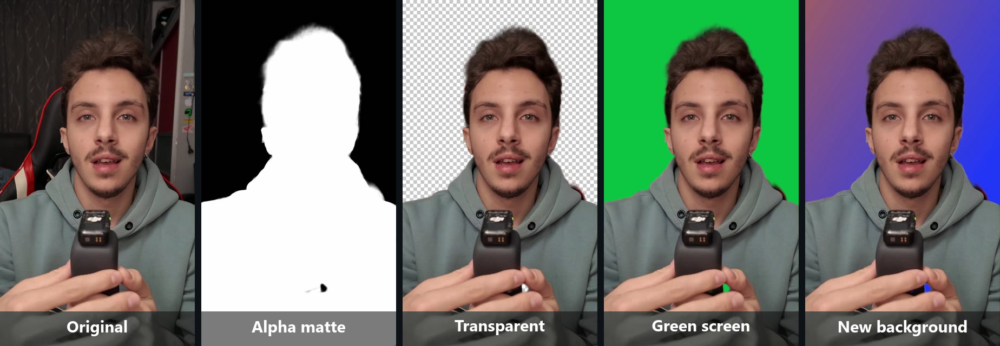
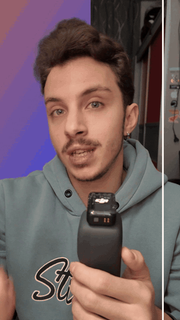
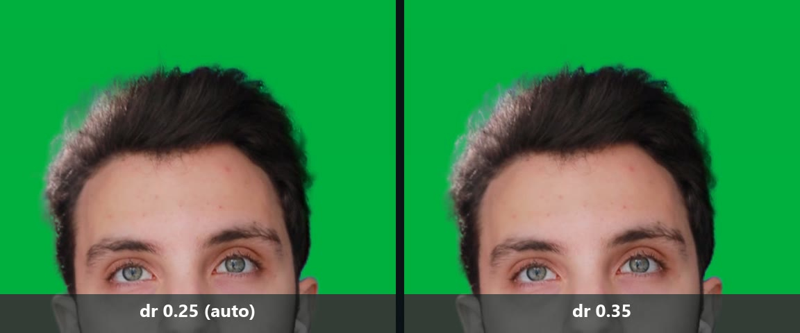
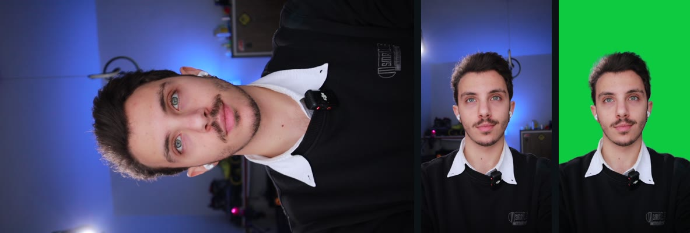
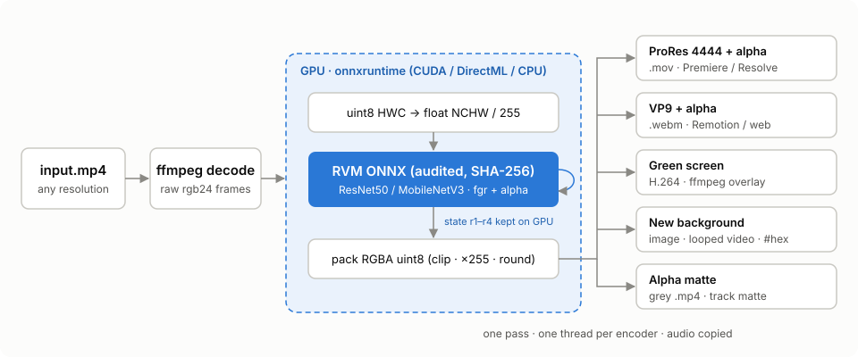
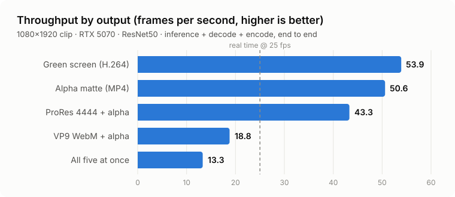
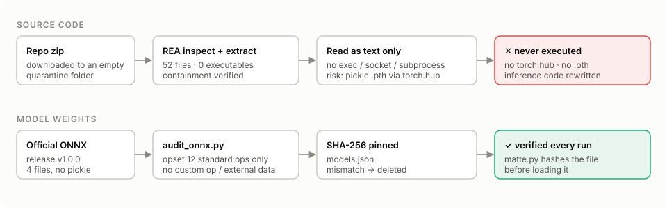

<h1 align="center">dekupe</h1>

<p align="center">
  <b>Local, GPU-fast video background removal — as a Claude Code skill and a plain CLI.</b><br>
  Robust Video Matting, audited and re-wrapped: no <code>torch.hub</code>, no pickle weights, no cloud.
</p>

<p align="center">
  <a href="#english">English</a> · <a href="#türkçe">Türkçe</a>
</p>

<p align="center">
  
</p>

<p align="center">
  
</p>

---

## English

**dekupe** (Turkish for *cut-out*) removes the background from talking-head and people footage on your own
machine, in one pass, at ~50 fps on a modern NVIDIA GPU. It uses the official ONNX export of
[Robust Video Matting](https://github.com/PeterL1n/RobustVideoMatting) (RVM), but **none of the upstream
Python code is ever executed** — the inference pipeline is written from scratch and the model files are
statically audited and pinned by SHA-256.

### What you get

| Flag | Output | Typical use |
|---|---|---|
| `--alpha cut.mov` | ProRes 4444 **with alpha** | Premiere Pro, DaVinci Resolve, Final Cut overlay track |
| `--webm cut.webm` | VP9 **with alpha** | Remotion `<OffthreadVideo transparent>`, the web |
| `--green green.mp4` | subject on flat green (`--key-color`) | any editor |
| `--bg photo.jpg --out new.mp4` | **new background**: image, looping video or `#hex` color | finished clip |
| `--matte alpha.mp4` | grey matte, white = subject | track matte / `alphamerge` |

Combine any of them — all are produced in a single pass, frame-accurate, with the original audio copied.

### Install

Requirements: Python 3.10+, `ffmpeg`/`ffprobe` on PATH. NVIDIA GPU recommended (CUDA via pip wheels, no
CUDA toolkit needed); AMD/Intel via DirectML; CPU works too.

```powershell
git clone https://github.com/furkannfuatt/dekupe.git
cd dekupe
powershell -ExecutionPolicy Bypass -File install.ps1            # NVIDIA (default)
# install.ps1 -Runtime directml   |   install.ps1 -Runtime cpu
```
```bash
./install.sh            # Linux / macOS (CUDA on Linux if nvidia-smi exists, else CPU)
```

The installer copies the skill to `~/.claude/skills/dekupe`, creates its own virtual environment,
downloads the four ONNX models (≈180 MB) from the official RVM release, **verifies their SHA-256** and
runs the static audit. Anything that doesn't match is deleted.

### Use it

**With Claude Code** — just ask, in any project:

> "Remove the background from `interview.mp4` and give me a transparent ProRes"
> · "arka planı kes, yeşil ekran yap" · `/dekupe video.mp4`

The skill picks sensible settings, previews a few frames, rotates sideways footage, runs the job and
checks the result.

**From the command line** (Windows path shown; on Linux/macOS use `.venv/bin/python`):

```bash
PY=~/.claude/skills/dekupe/.venv/Scripts/python
M=~/.claude/skills/dekupe/scripts/matte.py

$PY -I $M input.mp4 --alpha cut.mov --matte alpha.mp4         # for your editor
$PY -I $M input.mp4 --bg beach.jpg --out beach.mp4            # replace the background
$PY -I $M input.mp4 --max-frames 50 --green preview.mp4       # 2-second preview first
```

| Option | Meaning |
|---|---|
| `--model auto\|resnet50\|mobilenetv3` | auto = ResNet50 on GPU (same speed, better hair), MobileNetV3 on CPU |
| `--dr 0.35` | downsample ratio; auto targets 480 px on the long side (0.25 at 1080×1920). Raise it for fine or backlit hair |
| `--full-body` | auto ratio for full-body / wide shots (0.4 at 1080p) |
| `--use-src` | keep original pixels instead of RVM's spill-cleaned foreground |
| `--max-frames N` | process only the first N frames |
| `--device cuda\|dml\|cpu`, `--precision fp32\|fp16` | rarely needed |

### Tuning: `--dr`

Close-ups with backlit hair keep a soft halo at the default ratio. `--dr 0.35` tightens the edge (≈9 %
fewer semi-transparent pixels on this clip) at no speed cost:

<p align="center"></p>

### Sideways footage

Cameras often record vertical videos as 1920×1080 with the person lying on their side and no rotation
flag. RVM expects upright people, so rotate first — the Claude skill does this automatically:

```bash
ffmpeg -i in.mp4 -vf transpose=1 -c:v libx264 -crf 14 -c:a copy upright.mp4   # head on the left → transpose=1
```

<p align="center"></p>

### How it works

<p align="center"></p>

The audited graph is wrapped **in memory** with a few standard ONNX nodes (uint8 → float, NCHW, RGBA
packing), so only 8-bit frames cross the PCIe bus and the recurrent state never leaves the GPU
(IOBinding). Compositing is done by ffmpeg's `overlay`, H.264 by NVENC when available, and every encoder
is fed from its own thread. The first naive NumPy version ran at 2.7 fps; this one runs at 50+.

<p align="center"></p>

### Why "audited"?

The upstream project loads weights with `torch.hub` / `torch.load`. `.pth` files are Python pickles —
loading one can execute arbitrary code — and `torch.hub` also runs the repository's `hubconf.py` straight
from GitHub at call time. dekupe avoids all of that:

<p align="center"></p>

- The source archive was inspected and extracted with [REA](https://github.com/morluto/rea) in a
  quarantine folder (52 files, 0 executables, containment verified) and only ever **read as text**.
- The four ONNX files were checked by `audit_onnx.py`: opset-12 standard operators only, no custom
  domains, no external data, exact RVM inputs/outputs. ONNX graphs of standard ops cannot run code.
- Their SHA-256 hashes are pinned in `models.json`; `fetch_model.py` deletes mismatches and `matte.py`
  re-hashes the file on **every** run before loading it.

Full report: [`skill/dekupe/references/AUDIT.md`](skill/dekupe/references/AUDIT.md).

### Limits

- Trained for people. Things a person holds are usually kept; objects lying around are not.
- Recurrent model: the first ~10 frames can be softer; matte separate shots separately if a hard cut
  leaves ghosting.

### Credits & license

- Model: **Robust Video Matting** — Shanchuan Lin, Linjie Yang, Imran Saleemi, Soumyadip Sengupta,
  *Robust High-Resolution Video Matting with Temporal Guidance*, WACV 2022.
  [github.com/PeterL1n/RobustVideoMatting](https://github.com/PeterL1n/RobustVideoMatting) (GPL-3.0).
- Static analysis: [REA](https://github.com/morluto/rea).
- dekupe is free software under the **GNU GPL v3** ([LICENSE](LICENSE)), the same license as the RVM
  weights it downloads. Use it, change it, share it.

---

## Türkçe

**dekupe**, videolardaki kişinin arka planını **kendi bilgisayarında**, tek geçişte ve modern bir NVIDIA
ekran kartında saniyede ~50 kare hızla keser. [Robust Video Matting](https://github.com/PeterL1n/RobustVideoMatting)
modelinin resmî ONNX sürümünü kullanır ama **orijinal projenin hiçbir Python kodu çalıştırılmaz**:
çıkarım kodu baştan yazıldı, model dosyaları statik olarak denetlendi ve SHA-256 ile sabitlendi.

### Ne üretir

| Bayrak | Çıktı | Nerede kullanılır |
|---|---|---|
| `--alpha cut.mov` | Şeffaf ProRes 4444 | Premiere, DaVinci Resolve, Final Cut |
| `--webm cut.webm` | Şeffaf VP9 | Remotion, web |
| `--green green.mp4` | Yeşil ekran | her kurgu programı |
| `--bg foto.jpg --out yeni.mp4` | Yeni arka plan (resim, döngülü video, `#renk`) | hazır klip |
| `--matte alpha.mp4` | Siyah-beyaz maske | Track Matte |

Hepsi aynı anda, tek geçişte, kare kare hizalı ve orijinal sesle üretilir.

### Kurulum

Gerekenler: Python 3.10+, PATH'te `ffmpeg`/`ffprobe`. NVIDIA ekran kartı önerilir (CUDA pip ile gelir,
ayrıca CUDA kurmaya gerek yok); AMD/Intel için DirectML, ekran kartı yoksa CPU.

```powershell
git clone https://github.com/furkannfuatt/dekupe.git
cd dekupe
powershell -ExecutionPolicy Bypass -File install.ps1
```

Kurulum skill'i `~/.claude/skills/dekupe` klasörüne kopyalar, kendi sanal ortamını kurar, 4 modeli resmî
RVM sürümünden indirip **hash'lerini doğrular** ve statik denetimi çalıştırır.

### Kullanım

**Claude Code ile:** herhangi bir projede "şu videonun arka planını kes", "şeffaf video yap", "yeşil ekran
yap" demen ya da `/dekupe video.mp4` yazman yeterli. Skill önizleme alır, yan çekilmiş videoyu kendisi
döndürür, işi çalıştırır ve sonucu kontrol eder.

**Komut satırından:**

```bash
PY=~/.claude/skills/dekupe/.venv/Scripts/python
$PY -I ~/.claude/skills/dekupe/scripts/matte.py video.mp4 --alpha kesim.mov --green yesil.mp4
```

İpuçları:
- Saçta hafif hale kalırsa `--dr 0.35` dene (yukarıdaki karşılaştırma görseli).
- Tam boy çekimlerde `--full-body`.
- Kamera dikey videoyu yan kaydettiyse önce `transpose=1` ile döndür (Claude skill'i bunu kendisi yapar).
- Uzun videolarda önce `--max-frames 50` ile 2 saniyelik önizleme al.

### Neden "denetlenmiş"?

Orijinal proje ağırlıkları `torch.hub` / `torch.load` ile yükler. `.pth` dosyaları pickle formatındadır,
yani yüklenince içlerindeki kodu çalıştırabilirler; `torch.hub` da GitHub'daki `hubconf.py`'yi o an
çalıştırır. dekupe bunların hiçbirini kullanmaz: kaynak kod [REA](https://github.com/morluto/rea) ile
karantinada incelendi ve sadece okundu, modeller sadece standart ONNX işlemleri içerdiği doğrulanıp
hash'leri sabitlendi, her çalıştırmada hash yeniden kontrol edilir. Ayrıntılar:
[`AUDIT.md`](skill/dekupe/references/AUDIT.md).

### Lisans

GNU GPL v3 — indirdiği RVM modelleriyle aynı lisans. Ücretsiz kullan, değiştir, paylaş.
Model: Lin vd., *Robust High-Resolution Video Matting with Temporal Guidance*, WACV 2022.
